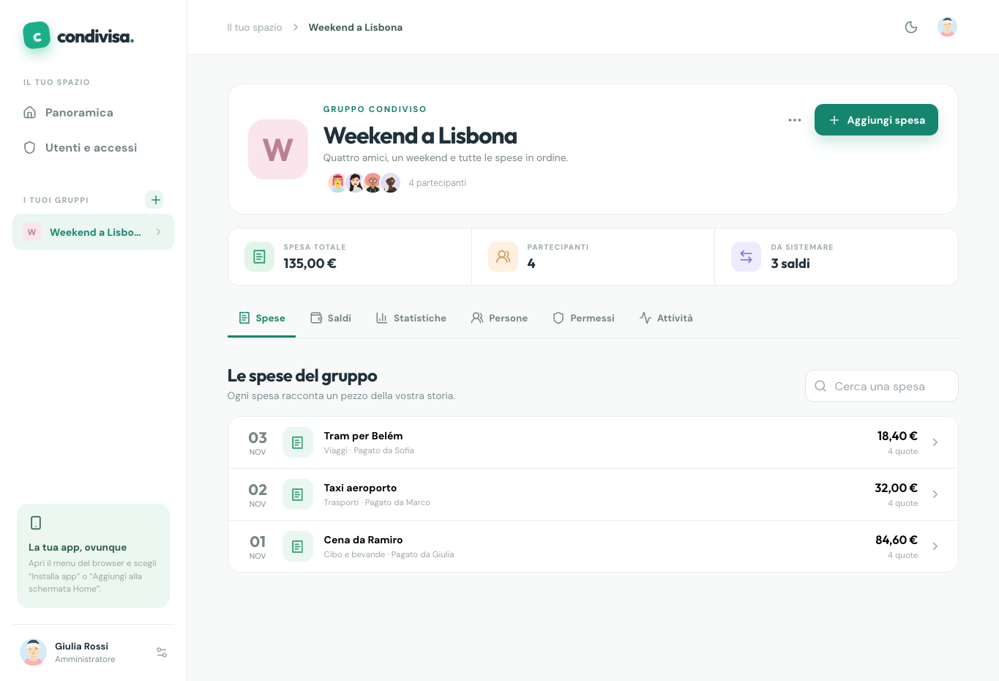
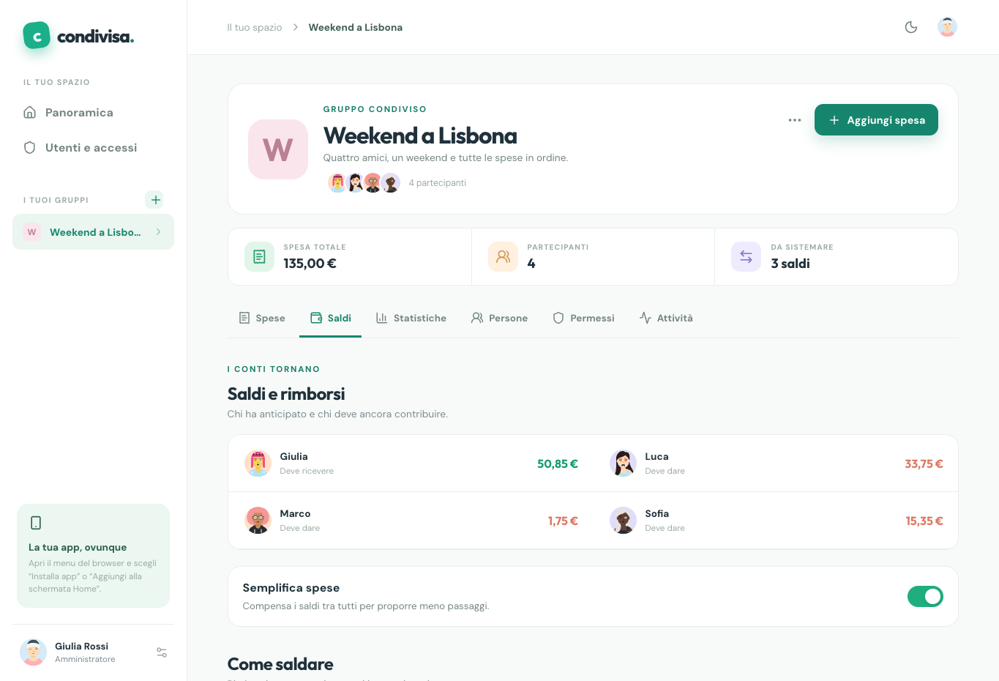
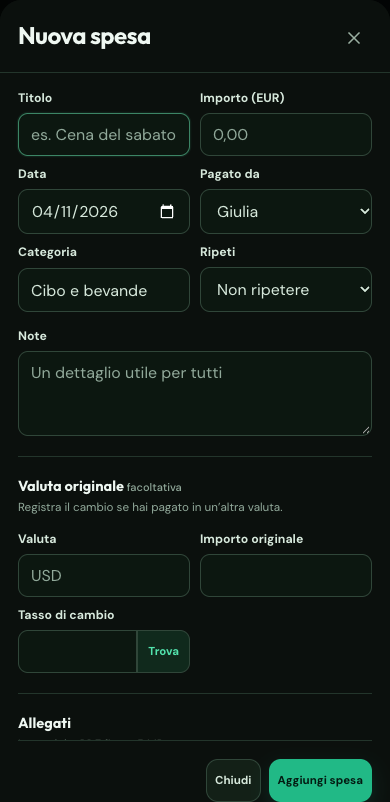
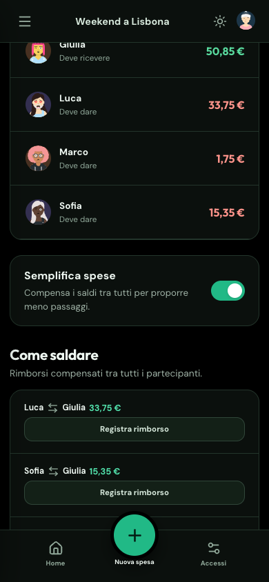

# Condivisa

App per dividere spese di gruppo, installabile dal browser su iPhone e Android. Frontend React PWA, API Fastify e database SQLite: il server è autonomo. Spliit è servito da riferimento funzionale; questo repository non usa il suo backend.

Ispirazione funzionale: [Spliit](https://github.com/spliit-app/spliit) di Sebastien Castiel (licenza MIT). Condivisa è un'implementazione autonoma distribuita con licenza MIT.

## Anteprima

Schermate reali della versione `v0.2.0`, acquisite con gruppi e persone di esempio. Nessun dato personale è incluso.

### Panoramica e spese






### Permessi per persona


### Tema AMOLED su mobile

| Panoramica | Spese e azione centrale | Nuova spesa |
| --- | --- | --- |
|  |  |  |

Con più gruppi, l'azione centrale chiede dove registrare la spesa:




Le immagini sono riproducibili con [`e2e/showcase.mjs`](e2e/showcase.mjs) su un'istanza temporanea con database vuoto.

## Funzioni

- Account personali, sessioni protette da cookie, inviti monouso validi 7 giorni.
- Cambio password personale e reset da parte di un amministratore, con chiusura delle sessioni precedenti.
- Isolamento dei gruppi verificato da ogni endpoint API. Un invitato non può creare gruppi propri salvo autorizzazione esplicita dell'amministratore.
- Permessi per persona e gruppo: visualizzare, aggiungere spese, modificare le proprie o tutte, gestire il gruppo e i membri, esportare, eliminare.
- Partecipanti distinti dagli account e associabili da **Persone**. Quote uguali, a pesi, percentuali o importi esatti; saldi e rimborsi.
- Opzione **Semplifica spese** in **Saldi**: attiva per impostazione predefinita, compensa i saldi fra tutti; disattivata mostra i rimborsi diretti tra partecipanti, compensati a coppie. La scelta è salvata per gruppo e modificabile da chi gestisce il gruppo.
- Spese ricorrenti, categorie, statistiche, attività, allegati immagine/PDF, export CSV/JSON e cambio valuta su richiesta.
- Gruppi eliminati nascosti e ripristinabili dall'amministratore in **Utenti e accessi**. Non esiste eliminazione definitiva automatica.
- Tema chiaro e tema scuro AMOLED con sfondo nero, selezionabili anche prima del login; modalità automatica in base al dispositivo.
- Pulsante rapido chiaro/AMOLED nella barra superiore; scelta completa, inclusa la modalità automatica, nell'account. Avatar Avataaars generati localmente dai nomi e colori dei gruppi stabili anche se cambia l'ordine della lista.
- Azione mobile centrale “Nuova spesa” quando hai un gruppo scrivibile; scelta del gruppo se ne hai più di uno. Se non hai gruppi scrivibili ma puoi crearne, diventa “Nuovo gruppo”.

## Sviluppo locale

Richiede Node.js 26 e npm.

```sh
npm ci
cp .env.example .env
# In due terminali:
set -a; . ./.env; set +a; npm run dev:api
npm run dev
```

Aprire `http://127.0.0.1:5173`. Alla prima apertura, creare l'amministratore usando `SETUP_KEY`. La chiave deve essere lunga, casuale e privata; il server la usa solo per la configurazione iniziale. Lo stack Portainer richiede comunque che resti impostata. Per la produzione il database e gli allegati stanno in `/data`; fai il backup di **entrambi**. Con SQLite in WAL, esegui il backup con il container fermo oppure usa la API di backup SQLite, non copiare il solo file principale mentre il server è attivo.

## NAS / Portainer

In **Portainer → Stacks**, incolla questo Compose. Prima del deploy sostituisci `spese.example.com` e la chiave di esempio con il tuo hostname e una chiave casuale di almeno 24 caratteri. Il tag dell'immagine è fissato a `v0.2.0`.

```yaml
services:
  app:
    image: ghcr.io/p4xx07/condivisa:v0.2.0
    restart: unless-stopped
    ports:
      - "127.0.0.1:3000:3000"
    environment:
      PUBLIC_ORIGIN: https://spese.example.com
      SETUP_KEY: sostituisci-con-una-chiave-casuale-di-almeno-24-caratteri
      PORT: "3000"
      # Database SQLite incluso nell'app, persistente nel volume qui sotto.
      DB_PATH: /data/condivisa.sqlite
      # Foto e PDF allegati alle spese, nello stesso volume.
      UPLOAD_DIR: /data/uploads
    volumes:
      - condivisa_data:/data
volumes:
  condivisa_data:
```

Questo è lo stack completo: Condivisa usa **SQLite integrato**, quindi il database è il file `/data/condivisa.sqlite` e non richiede un altro servizio Docker. `UPLOAD_DIR` indica la cartella `/data/uploads` per foto degli scontrini e PDF allegati alle spese; non è una cartella per caricare l'app. Il volume `condivisa_data` conserva sia il database sia gli allegati quando aggiorni o ricrei il container. Per un backup completo salva l'intero volume con il container fermo.

1. Configura un hostname pubblico HTTPS nel reverse proxy del NAS, con certificato valido. Inoltra le richieste HTTP al NAS sulla porta scelta, per esempio `3000`, conservando `Host` e `X-Forwarded-Proto`.
2. Se preferisci usare `compose.portainer.yaml`, imposta `PUBLIC_ORIGIN`, `SETUP_KEY` e, se necessario, `HOST_PORT` nello stack. `IMAGE` è facoltativa e predefinita a `ghcr.io/p4xx07/condivisa:v0.2.0`. L'immagine è pubblica e si scarica senza login GHCR.
3. Per costruire localmente usa `compose.yaml` con le stesse variabili e `docker compose up -d --build`.
4. Apri l'hostname HTTPS, configura l'amministratore e crea il primo gruppo. Il volume `condivisa_data` conserva database e allegati tra ricreazioni dello stack.
5. Su iPhone apri l'URL in **Safari**, tocca **Condividi → Aggiungi alla schermata Home**. Su Android usa il comando **Installa app** del browser. Il browser deve raggiungere il server via HTTPS; la PWA non sincronizza spese offline.

`PUBLIC_ORIGIN` deve essere l'origine esatta usata dal browser (schema e hostname, senza slash finale). La API la usa per verificare l'origine delle scritture, generare link di invito e impostare il cookie Secure. Se cambi hostname, aggiorna `PUBLIC_ORIGIN` e ricrea il container. Il certificato è gestito separatamente dal reverse proxy.

Il Compose espone la porta solo su `127.0.0.1` del NAS, per il reverse proxy installato sullo stesso host. Se il proxy gira in un altro container, adatta la rete Docker e il binding della porta. Non esporre il container senza HTTPS su Internet. In produzione il server rifiuta l'avvio senza `PUBLIC_ORIGIN` HTTPS e, al primo avvio, senza `SETUP_KEY` sufficientemente lunga.

## Verifiche

```sh
npm run lint
npm run test:api
npm run build
node e2e/smoke.mjs
# Con l'immagine di produzione avviata su 127.0.0.1:13000:
node e2e/production.mjs
```

Il test browser richiede un server di sviluppo attivo e un browser Playwright disponibile. Il test di produzione verifica manifest, service worker e assenza di richieste a font esterni. Il Dockerfile produce una singola immagine multiarchitettura; `.github/workflows/release.yml` esegue lint, test API, build e test browser prima di pubblicarla su GHCR al push di un tag `v*`. Il rilascio pubblica immagini per `linux/amd64` e `linux/arm64`; controlla l'esito della pipeline prima di aggiornare lo stack.

## Note operative

I permessi sono applicati lato server. La revoca di un membro è immediata anche se ha ancora una sessione valida. I link di invito sono monouso e devono essere condivisi solo con il destinatario. Il rate limit per account/invito è in memoria e presuppone un solo container; configura anche un limite per IP nel reverse proxy. Le migrazioni del database sono numerate ed eseguite in transazione all'avvio; il server rifiuta database creati da una versione più recente dell'app. Fai un backup prima di aggiornare l'immagine.

La lista delle spese ricorrenti è aggiornata quando qualcuno apre spese, saldi o statistiche del gruppo. Per un gruppo inattivo non viene eseguita una pianificazione in background. Il cambio valuta consulta Frankfurter e richiede accesso Internet dal server.

Il manifest PWA usa colori di avvio statici condivisi dai due temi; dopo il caricamento, l'app aggiorna il colore dell'interfaccia in base alla scelta salvata. La schermata di avvio dipende dal browser e va controllata sul dispositivo iPhone o Android effettivo.

Gli avatar sono generati nel browser con [DiceBear](https://www.dicebear.com/) e lo stile [Avataaars di Pablo Stanley](https://avataaars.com/), utilizzabile gratuitamente anche per progetti commerciali. I nomi non vengono inviati a un servizio esterno per crearli.
