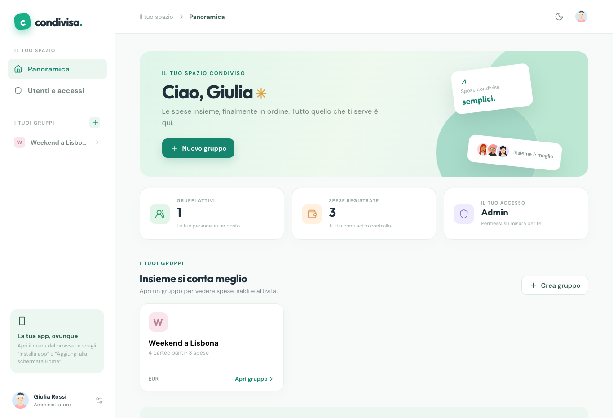
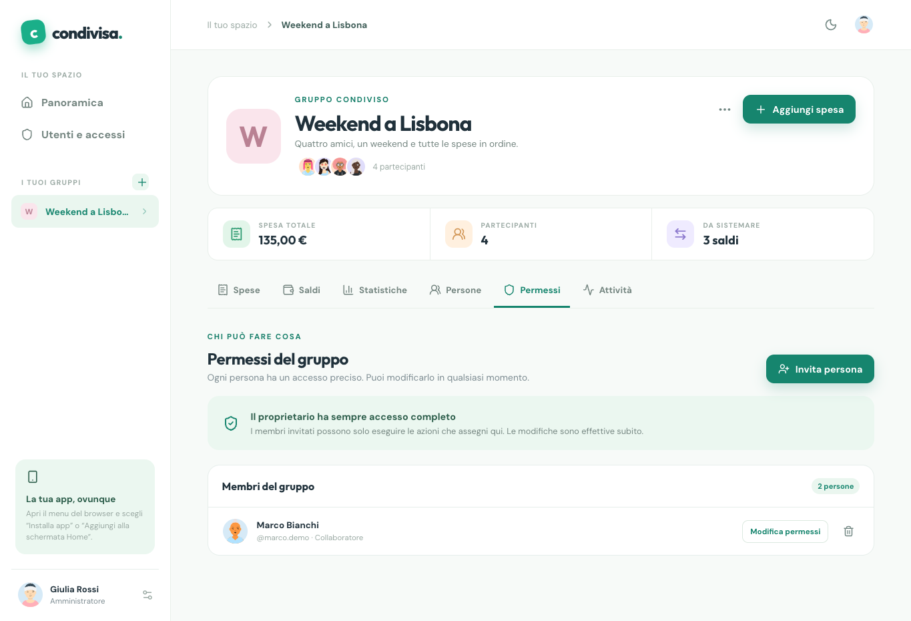
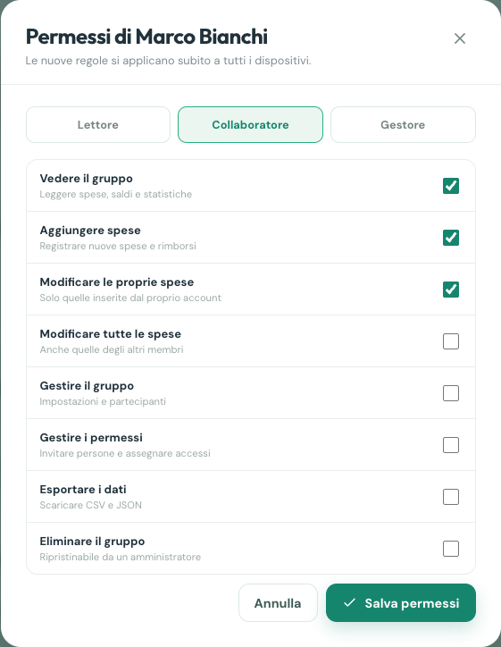
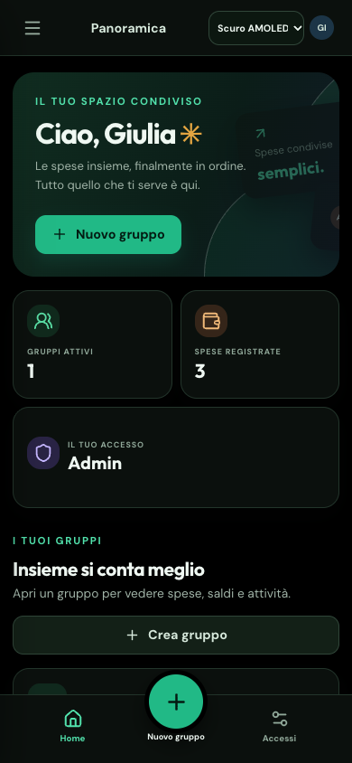
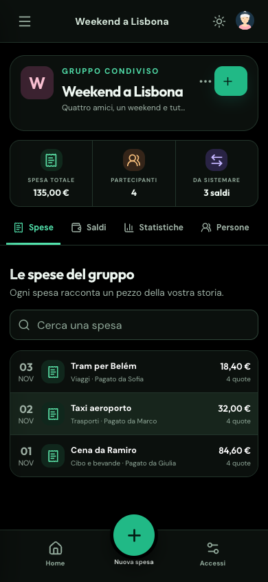
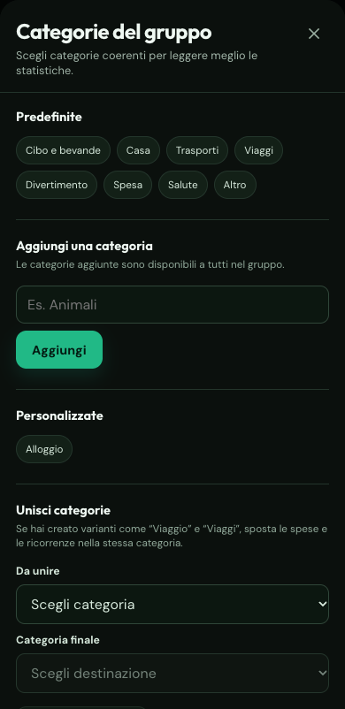

# Condivisa

Condivisa is a self-hosted group expense app that can be installed from a browser on iPhone and Android. It has a React PWA frontend, a Fastify API, and an embedded SQLite database. It is an independent implementation: it does not use the Spliit backend.

The product takes functional inspiration from [Spliit](https://github.com/spliit-app/spliit) by Sebastien Castiel (MIT license). Condivisa is distributed under the MIT license. **The app interface is currently in Italian.**

## Screenshots

These are real screenshots of `v0.3.0`, captured with sample groups and people. They contain no personal data.

### Overview and expenses




### Permissions per person





### AMOLED theme on mobile

| Overview | Expenses and primary action | New expense |
| --- | --- | --- |
|  |  |  |

When you can add expenses to multiple groups, the central action asks which group to use:




You can reproduce these screenshots with [`e2e/showcase.mjs`](e2e/showcase.mjs) against a temporary instance with an empty database.

## Features

- Personal accounts, cookie-based sessions, and single-use invitations valid for seven days.
- Personal password changes and administrator password resets, with older sessions invalidated.
- Group access checked by every API endpoint. An invited user cannot create their own groups unless an administrator grants that permission.
- Per-person, per-group permissions for viewing, adding expenses, editing own or all expenses, managing groups and members, exporting, and deleting groups.
- Expense participants can be linked to user accounts. Split costs equally, by shares, by percentage, or by exact amounts; view balances and suggested reimbursements.
- A group-level **Simplify expenses** option in Balances. Enabled by default, it offsets balances across the whole group; disabled, it shows direct reimbursements between participants, offset pairwise. Group managers can change the setting.
- Recurring expenses, saved per-group categories with predefined choices and a separate custom-category action, statistics, activity history, image/PDF attachments, CSV/JSON export, and currency conversion on request. Group managers can merge duplicate legacy categories without losing expenses or recurring rules.
- Soft-deleted groups can be restored by an administrator from the user administration page. There is no automatic permanent deletion.
- Light and true-black AMOLED themes, plus a system setting. The top bar has a compact light/AMOLED toggle; the full choice is in account settings and is also available before login.
- Avataaars generated locally from names, and group colors that remain stable when the group list changes order.
- A central mobile **New expense** action for users who can add expenses. It opens a group picker when needed and becomes **New group** only when no writable group is available and group creation is allowed.

## Local development

Requires Node.js 26 and npm.

```sh
npm ci
cp .env.example .env
# Run these in two terminals:
set -a; . ./.env; set +a; npm run dev:api
npm run dev
```

Open `http://127.0.0.1:5173`. On first launch, create the administrator with `SETUP_KEY`. Use a long, random, private value. The server uses it only for initial setup; the provided Portainer Compose file still requires the variable to be set on every deployment.

In production, the database and attachments live under `/data`. Back up **both**. SQLite uses WAL mode: stop the container before copying the complete data volume, or use SQLite's backup API. Do not copy only the main database file while the server is running.

## NAS / Portainer

Paste this complete stack into **Portainer → Stacks**. Before deploying, replace `spese.example.com` with your HTTPS hostname and replace the example setup key with a random value of at least 24 characters. The image is pinned to `v0.3.0`.

```yaml
services:
  app:
    image: ghcr.io/p4xx07/condivisa:v0.3.0
    restart: unless-stopped
    ports:
      - "127.0.0.1:3000:3000"
    environment:
      PUBLIC_ORIGIN: https://spese.example.com
      SETUP_KEY: replace-with-a-random-setup-key-at-least-24-characters-long
      PORT: "3000"
      # SQLite database included in the app, stored in the volume below.
      DB_PATH: /data/condivisa.sqlite
      # Photos and PDFs attached to expenses, stored in the same volume.
      UPLOAD_DIR: /data/uploads
    volumes:
      - condivisa_data:/data
volumes:
  condivisa_data:
```

This is the full application stack. SQLite is embedded, so the database is the file `/data/condivisa.sqlite`; no separate database container is required. `UPLOAD_DIR` is the directory for receipt photos and PDF attachments. The `condivisa_data` volume preserves the database and attachments when the container is recreated. Back up the entire volume with the container stopped.

### Website, API, and Synology reverse proxy

The **same `app` container** serves the built website and PWA files at `/` and the API at `/api/*`, all on container port `3000`. There is no separate web server or frontend container. Visitors open your HTTPS hostname in a browser; Safari can then add the PWA to the iPhone Home Screen. The browser downloads the app files from this server, not from an app store.

For the Compose example above, create one reverse proxy rule in **DSM 7 → Control Panel → Login Portal → Advanced → Reverse Proxy**:

| Synology field | Value |
| --- | --- |
| Source protocol | `HTTPS` |
| Source hostname | `spese.example.com` (replace with your hostname) |
| Source port | `443` |
| Destination protocol | `HTTP` |
| Destination hostname | `127.0.0.1` |
| Destination port | `3000` |

Assign a valid certificate to the source hostname and set `PUBLIC_ORIGIN=https://spese.example.com` in the stack. Forward the entire hostname to the container: both `/` and `/api/*` must reach it. If you change `HOST_PORT` in `compose.portainer.yaml`, use that host port as the Synology destination port; the container's internal port remains `3000`. Only HTTPS port `443` needs to be reachable externally for this hostname. See [Synology's reverse proxy settings](https://kb.synology.com/en-global/DSM/help/DSM/AdminCenter/system_login_portal_advanced) for the DSM fields.

1. Configure a public HTTPS hostname and a valid certificate in your NAS reverse proxy. Forward HTTP requests to the chosen NAS port (for example, `3000`) while preserving `Host` and `X-Forwarded-Proto`.
2. If you prefer [`compose.portainer.yaml`](compose.portainer.yaml), set `PUBLIC_ORIGIN` and `SETUP_KEY` in Portainer, and optionally `HOST_PORT`. `IMAGE` defaults to `ghcr.io/p4xx07/condivisa:v0.3.0`. The image is public and can be pulled without GHCR credentials.
3. To build locally, use `compose.yaml` with the same variables and run `docker compose up -d --build`.
4. Open the HTTPS hostname, set up the administrator, and create your first group. The named volume preserves data across stack updates.
5. On iPhone, open the URL in **Safari** and choose **Share → Add to Home Screen**. On Android, use the browser's **Install app** action. The browser must reach the server over HTTPS. The PWA does not sync expense changes offline.

`PUBLIC_ORIGIN` must exactly match the origin used by the browser (scheme and hostname, without a trailing slash). The API uses it to validate write requests, generate invitation links, and set Secure cookies. If the hostname changes, update `PUBLIC_ORIGIN` and recreate the container. The reverse proxy manages the certificate separately.

The example binds port `3000` only to `127.0.0.1` on the NAS, for a reverse proxy running on the same host. If your proxy runs in another container, adjust the Docker network and port binding. Do not expose the container directly to the internet without HTTPS. In production, the server refuses to start without an HTTPS `PUBLIC_ORIGIN`, and it requires a setup key of at least 24 characters for initial setup.

## Verification

```sh
npm run lint
npm run test:api
npm run build
node e2e/smoke.mjs
# With the production image running at 127.0.0.1:13000:
node e2e/production.mjs
```

The browser test requires a running development server and an available Playwright browser. The production test checks the manifest, service worker, and absence of external font requests. [The release workflow](.github/workflows/release.yml) runs lint, API tests, the build, and browser tests before publishing to GHCR on a `v*` tag. It publishes `linux/amd64` and `linux/arm64` images; check that the workflow succeeds before updating your stack.

## Operational notes

Permissions are enforced by the server. Removing a group member takes effect immediately even if that person still has a valid session. Invitation links are single-use and should be shared only with the intended recipient. Account/invitation rate limits are held in memory and assume a single app container; also configure a per-IP limit at the reverse proxy. Database migrations are versioned and run transactionally at startup. The server refuses to open a database created by a newer app version. Back up data before upgrading.

Recurring expenses are materialized when someone opens the group's expenses, balances, or statistics. Inactive groups do not have a background scheduler. Currency conversion uses Frankfurter and requires internet access from the server.

The PWA manifest uses static launch colors shared by both themes. After loading, the app updates the browser chrome color to match the saved choice. Check the launch screen on an actual iPhone or Android device.

Avatars are generated in the browser with [DiceBear](https://www.dicebear.com/) and [Avataaars by Pablo Stanley](https://avataaars.com/), whose style is free for personal and commercial use. Names are not sent to an external avatar service.
